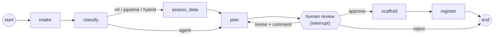
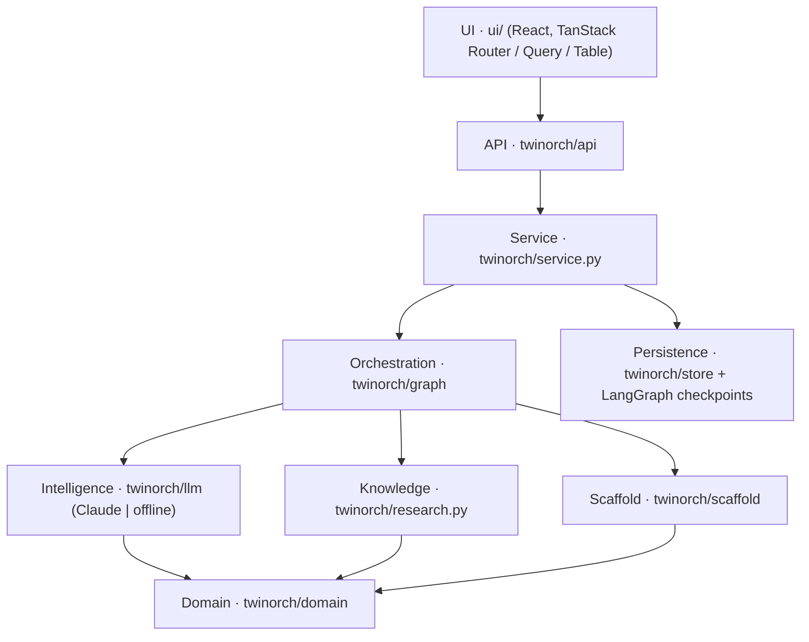

# Agentic Twin Orchestrator

A LangGraph pipeline that turns an idea from the field into a reviewed plan and a starter project. Every idea, whether an LLM agent, an ML model, a data pipeline or a hybrid, goes through the same steps, and nothing is built until you approve it.

## Run it

```bash
make setup          # Python env (+ UI build when npm is available)
make serve          # http://127.0.0.1:8000  (API + UI)
```

For UI work with hot reload, run `make serve` in one terminal and `make ui-dev` in another (http://localhost:5173).

From the terminal only:

```bash
.venv/bin/python -m twinorch run --title "Turbo failure early warning" \
  --problem "Turbo failures on 7.2L engines cause roadside breakdowns" \
  --outcome "Predict failure risk 7 days ahead per truck" --approve
```

### Planner: Claude or offline rules

| `TWIN_LLM` | Behaviour |
|---|---|
| `auto` (default) | Uses Claude when `ANTHROPIC_API_KEY` or `ANTHROPIC_AUTH_TOKEN` is set, otherwise the offline rules engine |
| `anthropic` | Always Claude (also works with an `ant auth login` profile) |
| `offline` | Deterministic keyword rules; no API calls, no cost. Used by the tests |

Other settings: `TWIN_MODEL` (default `claude-opus-5-5`), `TWIN_CLASSIFY_EFFORT` (default `low`), `TWIN_PLAN_EFFORT` (default `high`), `TWIN_MAX_REVISIONS` (default 5), `TWIN_DATA_DIR` (default `var/`), `TWIN_PROJECTS_DIR` (default `projects/`).

Claude calls use structured JSON outputs validated with pydantic, and server-side refusal fallbacks (`fallbacks="default"`). A refusal, truncation or API error marks the run **failed** with a readable message. It never crashes the server.

## The graph



| Node | What it does | Uses an LLM |
|---|---|---|
| intake | Validates and normalises the idea | No |
| classify | Picks the project kind and vehicle domains | Yes |
| assess_data | Matches domains to datasets in `research/data/dataset_inventory.csv` and lists fields that are not public (`data_dictionary.csv`) | No (deterministic) |
| plan | Writes the blueprint: components, milestones, metrics, risks, tools or models | Yes |
| review | Pauses with `interrupt()` until you approve, request changes or reject | No |
| scaffold | Writes a starter project to `projects/<name>/` | No |
| register | Records the project | No |

State is checkpointed to SQLite (`var/checkpoints.db`), so a run waiting for review survives a server restart.

## Layers



Outer layers call inner ones, never the reverse. The domain layer has no I/O.

## HTTP API

| Method | Path | Purpose |
|---|---|---|
| GET | `/api/health` | Version and active planner |
| GET | `/api/meta` | Project kinds, graph nodes and edges |
| POST | `/api/ideas` | Submit an idea; starts a run (201) |
| GET | `/api/runs` | All runs, newest first |
| GET | `/api/runs/{id}` | Run detail: state, timeline, visited nodes |
| POST | `/api/runs/{id}/review` | `{"action": "approve" \| "revise" \| "reject", "comment": "..."}`; 409 if the run is not waiting |
| GET | `/api/projects` | Scaffolded projects |
| GET | `/api/projects/{slug}` | Project file list |
| GET | `/api/projects/{slug}/file?path=` | File contents (confined to the project folder) |

## Adding a new kind of project

1. Add the kind to `ProjectKind` (`domain/models.py`) and describe it in `domain/catalog.py`.
2. Add file templates and dependencies in `scaffold/templates.py`.
3. If it needs data, add it to `KINDS_NEEDING_DATA` and map its domains in `TAG_DATASETS` / `TAG_FIELD_GROUPS`.
4. Run `make test`. The scaffold test compiles every generated Python file for every kind.

## Tests

`tests/test_orchestrator.py` covers every route through the graph, plus: the revision limit, restart recovery, scaffolds for all four kinds, the HTTP API, and the Claude adapter's request shape and refusal and truncation handling (against a fake client, so no API key or spend).
